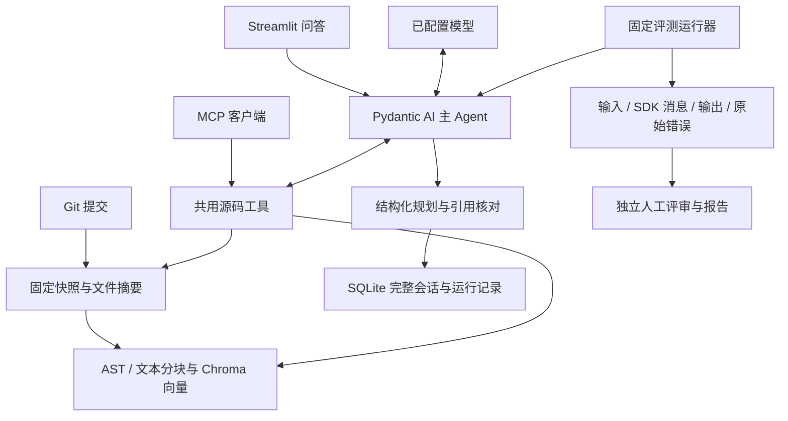

# 架构与技术取舍

Codebase Q&A 帮助开发者理解固定版本的代码，并获得可核对依据的修改方案。当前交付分析与规划，目标仓库的代码和规划命令不会执行。

## 关键边界

| 选择 | 解决的问题 | 限制 |
| --- | --- | --- |
| 固定 Git Commit 与独立索引集合 | 更新工作区或远端代码后，历史引用仍指向同一份源码；新索引回读后再发布 | 当前导入默认分支，任意分支选择尚未实现 |
| AST 与字面查找补充向量 | 精确定位符号、路径、导入和配置，减少仅靠文字相似度查代码 | Python 静态导入候选不是完整运行时调用图 |
| 单个主 Agent 共用六个工具 | 页面、评测使用同一工具实现，保留可比的输入输出 | 工具循环已实现，真实模型是否正确选择工具仍待评审 |
| 每轮独立证据表 | 只有实际读到且再次核对的源码才获得本轮引用；历史编号不能直接复用 | 行号与原文一致不证明文字结论正确 |
| 原生历史与 SQLite 事务 | 保留真正的工具上下文，完整轮次一次保存；失败不覆盖旧轮次 | 不自动总结长对话，可设置输入字符限制并拒绝超限 |
| 独立归档与评审包 | 输出封存后按摘要绑定评分，部分评审不冒充完整成绩 | 公开单仓库开发集不是隐藏集或跨仓库验证 |
| 显式运行策略 | 请求、工具、报告用量、异步超时可控制，保留原默认值 | Token 在响应后检查；不承诺严格费用封顶 |

工具允许读取的快照范围、文件类型及大小有应用层检查。这不等同于操作系统沙箱；没有加入自动补丁执行或隔离运行目标程序的能力。

## 检索实验

复用同一源版本与 533 个向量，固定原问题、Top 5 和嵌入模型，分别改变一个变量：

| 条件 | 部分重叠证据组 | 完整覆盖证据组 | 决定 |
| --- | --- | --- | --- |
| 原向量检索 | 1/47 | 1/47 | 保留默认 |
| 补充模块行 | 1/47 | 1/47 | 不切换默认分块 |
| 符号 / 路径 + 固定 RRF | 4/47 | 1/47 | 保留显式实验选项 |

这些是 18 个必要证据轮次的单次候选覆盖，未调用聊天模型，不代表完整 Agent 或回答准确率。[分块记录](checks/20261112-retrieval-modules.md)与[融合记录](checks/20261112-retrieval-hybrid.md)保存源码核对和全部候选位置。

## 评测来源

`local_fixture` 使用本地 `FunctionModel` 验证工具、会话及归档流程；`provider_fixture` 使用真实 SDK 和内存 `MockTransport`，验证请求、响应、用量和实际临时向量链路。两类均没有真实聊天请求。

`siliconflow` 真实入口只在原版 inspect / index / ask 全部成功、配置和依赖一致、专用索引逐条回读以及密钥齐备后执行。当前没有成功的原版真实问答记录，真实成绩为空；模拟基线只用于测试前置核对，不能代替成功基线。原 SDK 内部重试保留，外层运行器不重跑失败轮次。

当前不加入多 Agent、图数据库、独立前端或新的模型供应商。后续先用真实失败题决定需要补哪种检索、上下文或缓存策略。
