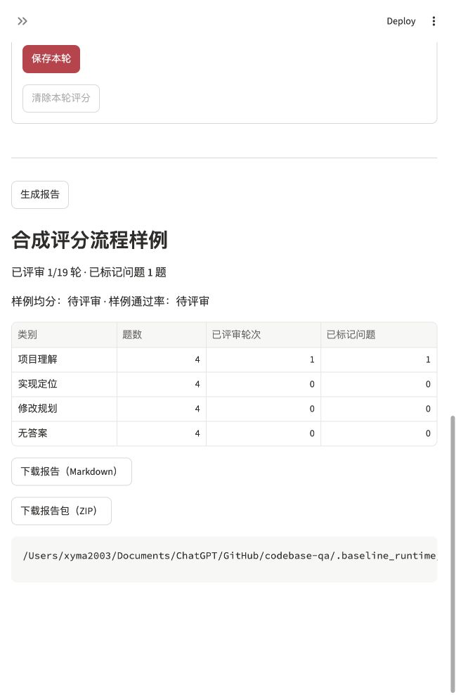

# 演示步骤

全部命令在项目根目录执行，先按 [README](../README.md) 安装依赖。使用包含完整历史的克隆，归档和固定标注需要读取原始 Git 对象。每次检查指定新输出路径，保留旧结果。

## 无聊天密钥的演示

### 1. 核对固定数据与已有归档

```bash
.venv/bin/python scripts/check_evaluation.py --output .baseline_runtime/demo-001/dataset.json
.venv/bin/python -m zipfile -e docs/checks/20261112-provider-evaluation-local.zip .baseline_runtime/demo-001/provider-fixture
.venv/bin/python scripts/verify_evaluation_archive.py .baseline_runtime/demo-001/provider-fixture
```

可看到固定 16 题、19 轮、31 段源码依据，以及已完成但尚未人工评分的接口模拟输出。这一步复用已有档案，不重新请求模型或建立索引。档案中的实际代码、源版本、参数、SDK 消息和输出各有记录；它验证来源及内容一致性，不替人工判断回答正确性。

### 2. 展示仓库、源码及会话

```bash
.venv/bin/python scripts/run_local.py --port 18524
```

打开页面，输入本项目 GitHub 地址。首次需要点击“克隆并索引”，会下载原嵌入模型，之后相同提交复用索引。点击“查看项目概览”，核对 Commit、目录、Python 模块和入口原文；这部分不需要聊天密钥。

该命令只演示本地操作员。默认网页已接入 OIDC，缺少登录配置时拒绝访问；真实身份服务商回调与密钥相关验收统一后置。双用户、角色及页面权限的无密钥测试见 `tests/test_user_access.py`。

本项目已有可用索引后，可以主动保存一个明确标记的两轮本地演示：

```bash
.venv/bin/python scripts/check_history_tools.py --output .baseline_runtime/demo-001/history.json
```

脚本复用当前已索引版本，只读取真实 `config.py`，不调用外部模型。在页面同一版本的“历史对话”选择“本地模拟：检查保存的对话和工具记录”，展开“工具调用”和“源码引用”。刷新后可恢复同一会话；点击“新建对话”开始新的上下文，原历史仍保留。该样例测试恢复与引用，文字明确标为本地模拟。

展开“运行设置”，可以看到默认缓存与向量检索，并主动启用每轮限制。不提交真实问题也能检查这些控件。

### 3. 展示人工评审与报告

在侧栏打开“评测评审”，在“运行归档目录”填入步骤 1 解压出的目录，选择新建评审记录。逐题查看原问题、回答、参考代码和四维规则；填写时写明只是演示评分，不将样例当真实模型成绩。

保存一轮后生成报告，应显示部分完成、完整均分与通过率仍待评审；可以继续完成或清除本轮评分。源档案保持封存，评分保存在独立工作包。下载报告可查看已标记失败题及源码材料。



## 配置密钥后的真实验收

先在原版检查点 `3aee328` 的独立目录建立真正成功的阶段零问答，核对配置与依赖，再执行[真实评测说明](../evaluation/README.md#后续真实评测)。密钥只放被忽略的 `.env`，不要填进文档或提交。

默认检索、模型、Prompt 和评审规则先固定；完成实际内容评分后，才独立选择 `--retrieval-strategy hybrid` 做可比实验。记录逐题改善与退化，不能把两次配置不同的分数直接说成提升。

当前没有真实模型回答准确率、完整方案成功率或账单成本结论，简历及演示应按已实现的工程能力描述。任意分支、长对话压缩、重排模型、自动补丁和隔离执行属于后续范围。
