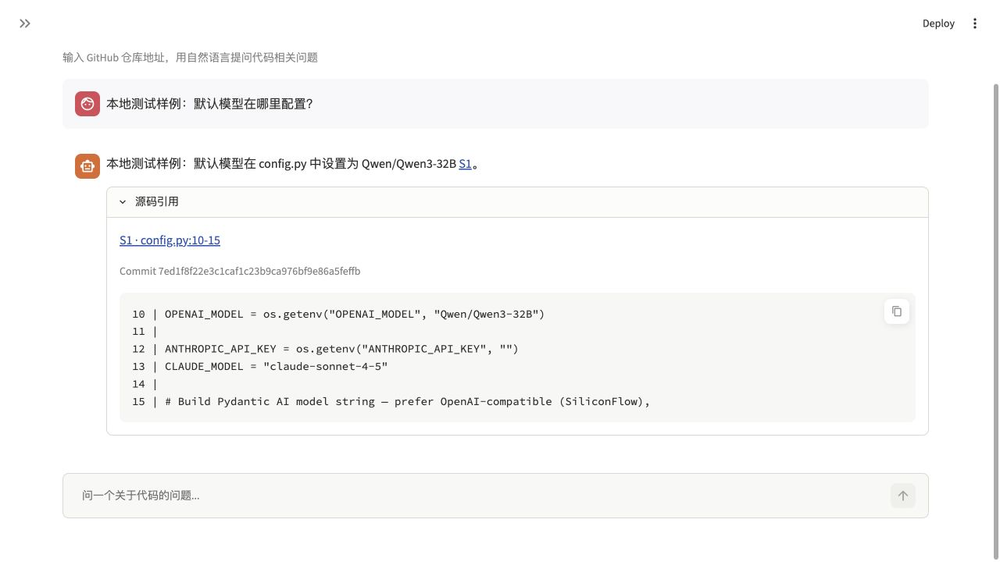

# 源码引用校验验收

日期：2026-11-10。结果：本功能的本地验收通过，没有调用真实聊天模型。

## 本次行为

版本化问答的搜索、读取工具从当前 Git 快照取得源码，为完整行分配本次问答的引用编号。回答中的 `[S1]` 等编号再次核对后，替换为程序生成的固定 Commit 链接；“源码引用”可展开查看行号、原文和完整版本。

检查内容为仓库身份、完整 Commit、文件 SHA256、有效行号和逐行原文。未知编号、错版本、错原文、越界、超长行的部分显示及被改动的文件不能作为有效引用。正文中自由书写的其他文件位置不自动标为已核对。

没有有效引用或引用有错误的版本化回答不进入问答缓存。旧缓存命中不自动登记为本次源码证据，需再次读取。此检查不证明结论被引用支持；语义正确性和回答准确率仍待后续评测。

## 验证结果

| 检查 | 结果与范围 |
| --- | --- |
| 本地测试 | 54 项通过，耗时 9.111 秒，含 36 项已有测试、16 项引用检查及 2 项新增页面检查。见[完整输出](20261110-citations-unittest.log)。 |
| 引用核心 | 核对原文、文件校验值、旧/新版本、中文与特殊字符路径、完整行范围；拒绝错误值、路径越界、超长行部分引用和读取后被改动的文件。 |
| 回答引用处理 | 重复读取去重，未知编号不通过；链接从快照生成，覆盖模型在编号后自行附加的 URL；围栏代码块和行内代码中的编号样例保持原样。 |
| 框架完整流程 | 用已安装 Pydantic AI 的本地 `FunctionModel` 模拟模型运行两轮：调用真实 `read_file` 工具，然后输出带编号的测试回答。验证实际工具注册、运行指令、版本传递、原文复核和结果回调。问答缓存写入被替换为记录器，没有实际保存测试答案。 |
| MCP stdio | 当前 6 个工具、10 次调用通过，包括有效原文、错误原文、错误版本、越界、路径穿越、布尔行号，以及选择失败后的上下文清空。布尔行号在协议参数校验时被拒绝。 |
| 页面 | AppTest 检查源码展开内容、固定版本链接、特殊路径显示、回答重绘后的引用保留，以及未知引用问题展示。浏览器打开实际页面组件，展开测试样例引用，确认完整 Commit、10–15 行原文及链接。 |
| GitHub 链接 | 通过 GitHub 连接器读取固定 Commit 的 `config.py`，核对其第 10–15 行与页面原文一致。 |

机器记录包含输入、输出、运行指令和 8 个文件的 SHA256，见[引用检查 JSON](20261110-citations.json)。原版与前两次功能验收记录保持原样。

页面样例明确标为“本地测试样例”，使用真实快照源码和预设回答；截图不是 SiliconFlow 生成结果：



## 配置与变更范围

代码起点为 `84d48b197f9ac086681ae4116d42de8f5c0e5723`。索引中的实际源码版本仍为 `7ed1f8f22e3c1caf1c23b9ca976bf9e86a5feffb`，两者用途不同。

- 模型、接口、依赖声明、嵌入模型、分块参数、Top K、质量评分与阈值没有修改，索引没有重建。
- 版本化问答新增 `Agent.run(instructions=...)` 引用格式要求，完整文本保存在 JSON 的 `instructions`；原有基础系统 Prompt 保留。无版本参数的旧调用不增加此指令。
- 新增的引用检查是版本化答案保存的必要条件，并非提高原评分阈值。
- 本地脚本启用离线缓存；`FunctionModel` 流程禁用外部模型请求。MCP 检查仅调用仓库与源码工具。

## 复查

在项目根目录运行：

```bash
.venv/bin/python -m unittest discover -s tests -v
HF_HOME="$PWD/.baseline_runtime/huggingface" HF_HUB_OFFLINE=1 .venv/bin/python scripts/check_citations.py --output docs/checks/next-citations.json
```

集成脚本需要本机已保存的原仓库快照与索引。新的运行应使用新输出文件，已有输出会被拒绝覆盖。真实 SiliconFlow 回答、引用格式遵循率、语义正确率和费用仍待密钥配置后验证。
