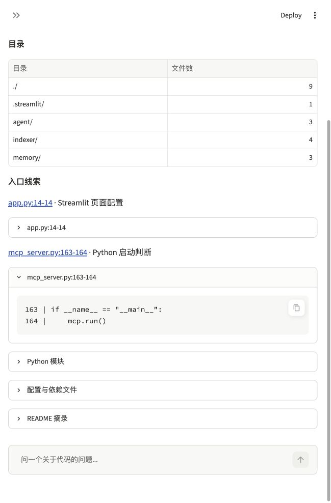

# 静态项目概览验收

日期：2026-11-10。结果：本功能本地验收通过。页面概览不依赖聊天模型，本次没有调用真实聊天模型。

## 本次行为

新增“查看项目概览”按钮和共用的 `get_repo_overview` 工具。它展示选定 Commit 的目录、Python 顶层定义及导入、模块文档摘录、配置文件名、根 README 摘录和入口线索。文件数来自排除依赖、构建目录后的 Git 快照清单，不是向量索引的文件数。

入口规则覆盖顶层 `__name__ == "__main__"` 判断、`__main__.py` 和 Streamlit `set_page_config` 调用，处理导入别名。不把字符串中的判断、函数内部页面配置或反向比较条件当作相同入口。规则不证明运行成功，不覆盖其他框架或所有语言的启动形式。

源码读取核对 SHA256。入口与 README 证据包含版本、行号、原文及固定链接；只保留完整行。文档与模块文本作为材料，不作为操作指令；不导入或执行目标代码。页面切换仓库或版本后清除旧概览。

## 验证结果

| 检查 | 结果与范围 |
| --- | --- |
| 本地测试 | 87 项通过，耗时 13.296 秒。包括 70 项已有测试、13 项概览测试和 4 项新增页面测试，见[完整输出](20261110-overview-unittest.log)。 |
| 静态事实 | 验证目录计数、顶层定义与导入、模块文档、配置文件名、三种入口规则及别名；没有入口时不虚构。 |
| 原文与范围 | 所有测试中的入口及 README 原文通过既有引用检查器；覆盖特殊路径链接、8000 字符边界、被改动文件、符号链接、错版本及旧快照保留。 |
| 资源与执行边界 | 覆盖字节/文件上限、列表截断、语法错误、二进制及大文件跳过；验证带文件写入语句的目标源码没有被执行。 |
| 页面回归 | 验证按需生成、同版本重绘保留、换版本清空、失败后清除旧结果及保留仓库选择，以及拒绝错版本返回。原更新按钮测试改为按标签定位，断言保留。 |
| 真实快照 | `7ed1f8f22e3c1caf1c23b9ca976bf9e86a5feffb`：20 个快照文件、13 个 Python 模块。入口线索是 `app.py:14` 的页面配置与 `mcp_server.py:163–164` 的启动判断。未受扫描限制，也没有跳过文件。 |
| MCP stdio | 当前 8 个工具，7 次调用通过：选择仓库、获取概览、再次核对入口原文、选择已有 SHA、相同版本结果一致、无效选择及其后的上下文清空。 |
| 框架流程 | 本地 `FunctionModel` 模拟模型实际运行“概览→按位置读取→引用”三轮。原文复核通过，问答缓存写入被替换为记录器，没有保存测试答案。 |
| 浏览器 | 实际本地页面生成概览，显示目录计数、完整 Commit、入口链接；展开 MCP 入口显示真实的 163–164 行。没有使用预设概览或模拟页面。 |

完整输入、输出及 8 个运行文件的 SHA256 见[机器记录](20261110-overview.json)。原索引身份保持不变，没有刷新或重建索引。



## 配置与复查

代码起点为 `07666b0e2d6accd8db3395696e0e7eb998a23858`。模型、接口、依赖声明、向量分块、嵌入模型、Top K、质量评分及阈值没有改动。Agent 工具说明和基本使用指令新增概览工具；用途及模块职责的模型说明、真实模型正确率和费用仍待密钥后验证。

概览最多列出 30 个目录、30 个配置文件、30 个 Python 模块和 20 条入口线索，每个模块最多列出 20 个顶层定义与导入。根 README 最多取前 20 行并遵守 8000 字符完整行范围；模块文档摘录最多 300 字符。扫描上限为单文件 1 MiB、总源码 10 MiB、2000 个候选文件。截断、受限和跳过均单独标记，没有发现线索不能证明没有入口。

在项目根目录运行：

```bash
.venv/bin/python -m unittest discover -s tests -v
HF_HOME="$PWD/.baseline_runtime/huggingface" HF_HUB_OFFLINE=1 .venv/bin/python scripts/check_overview.py --output docs/checks/next-overview.json
```

集成脚本使用本机已保存的原快照和索引，不刷新远端。新运行需选择新的输出文件，已有输出不会被覆盖。原版基线与此前验收记录保持原样。
