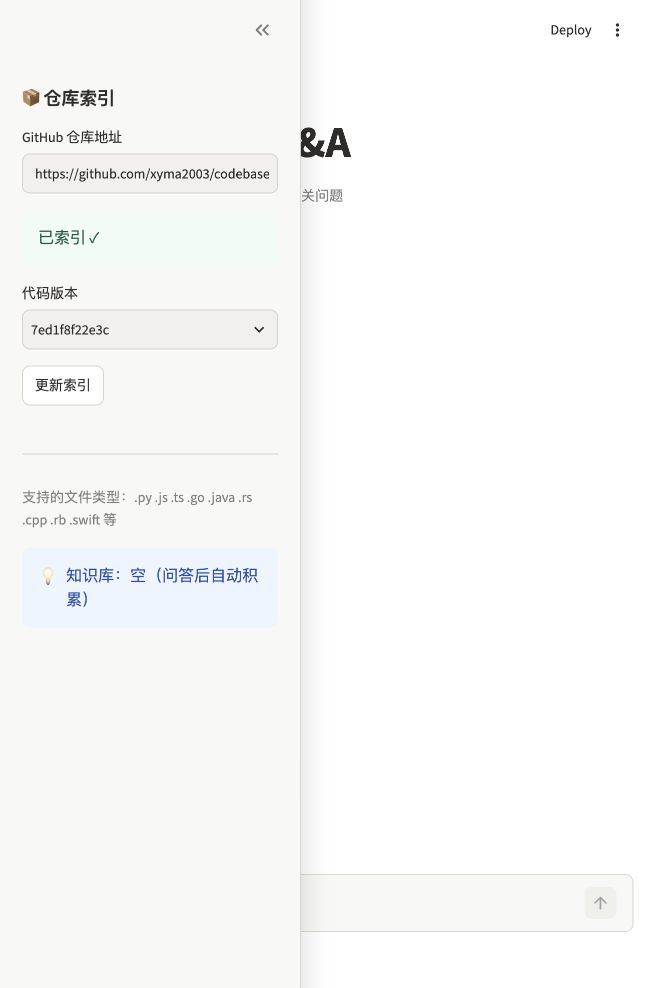

# 仓库快照与版本索引验收

日期：2026-11-10。结果：本功能验收通过。没有调用聊天模型。

## 本次行为

- 从 Git 已提交对象建立源码快照，记录完整 Commit SHA 和文件 SHA256。工作区修改、未跟踪文件、符号链接和子模块不混入快照。
- 每次更新先构建独立索引，完整回读后发布。失败保留旧版本；较早开始的并发任务不能覆盖较新的发布。
- 页面可以更新远端默认分支，并选择已成功索引的旧版本。搜索、按行读取和历史问答使用同一 Commit，切换版本清空当前显示的对话。
- MCP 新增 `list_repo_versions`，`set_repo` 支持刷新或选择已有完整 SHA。选择失败后清空上下文，避免误查上一个仓库。

## 检查结果

| 检查 | 结果与范围 |
| --- | --- |
| 本地测试 | `python -m unittest discover -s tests -v`，36 项通过，耗时 3.759 秒。包含 12 项原有源码读取测试、Git 快照与发布失败测试，以及 4 项 Streamlit AppTest。 |
| 真实向量迁移 | 16 个文件、58 个代码块，逐条比较内容、位置和嵌入配置后复用。迁移期间嵌入 `encode` 调用 0 次；原集合的 ID、正文、元数据和向量字节均未改变。 |
| 真实 Git 与 ChromaDB | 在隔离的本地 Git 仓库建立两个提交，两个版本分别检索到自己的内容，旧源码仍可读取。选择旧版本不改变最新发布位置。 |
| 受控失败 | 本地第三个版本在索引写入后主动触发回调异常。当前可用版本仍是第二个；本次未发布集合被清理，两个已完成集合保留。此处是测试注入异常，并非生产事故。 |
| 远端更新逻辑 | 本地裸 Git 远端测试确认抓取默认 HEAD，且不重置已有工作区。未用实际 GitHub 新提交模拟更新。 |
| MCP stdio | 共 5 个工具，7 次调用通过：选择、版本列表、按行读取、检索、拒绝无效地址、清空失败选择后的上下文、显式 SHA 选择。 |
| 页面 | 浏览器确认已有索引、版本 `7ed1f8f22e3c` 和更新按钮。AppTest 另外覆盖版本切换、仓库切换、失败保留旧版本，以及从旧选择更新回当前版本。 |
| 本地服务 | `http://127.0.0.1:18524/_stcore/health` 返回 `ok`。 |

真实存储与 MCP 的输入、输出及 9 个运行源码文件的 SHA256 保存在[机器记录](20261110-repository-versions.json)。其中 `native_storage` 的两个 SHA 是临时本地测试仓库的提交，不是 GitHub 业务仓库提交。

当前实际导入版本为 `7ed1f8f22e3c1caf1c23b9ca976bf9e86a5feffb`。开发成果提交在 `codex/stage0-baseline`，不会自动改变仓库默认分支所导入的代码。



## 复查命令

在项目根目录、已安装的独立环境中运行：

```bash
.venv/bin/python -m unittest discover -s tests -v
HF_HOME="$PWD/.baseline_runtime/huggingface" .venv/bin/python scripts/check_repository_versions.py --output docs/checks/next-repository-versions.json
```

真实检查依赖本机已有的原始集合和嵌入缓存，并非空目录安装检查。输出文件已存在时会提前停止，重新检查应选择新文件名。

## 尚未验证

SiliconFlow 密钥尚未配置，因此未验证真实模型回答、准确率或费用。Agent 版本参数传递已用模拟模型测试，不等同于真实模型验收。模型、Prompt、依赖声明和检索/记忆阈值均未改动。

任意分支选择、源码引用校验、真正的多轮上下文和流式模型输出仍在后续范围。第 0 阶段原版记录与本功能记录分开保存；不能把本次结果记成原版真实模型成功基线。
