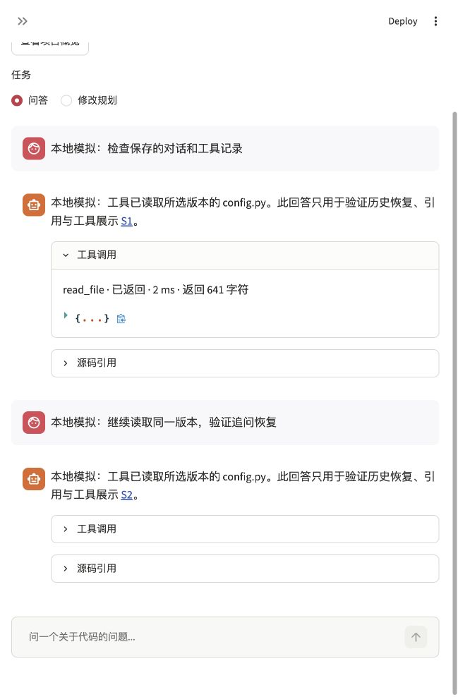

# 历史会话恢复与工具记录检查

日期：2026-11-12。功能：恢复已保存问答与引用，展示实际源码工具过程。

## 完成范围

- 侧栏按仓库、完整 Commit 和集合筛选历史会话，只列出至少完成一轮的记录。
- 恢复原问题、回答、源码引用、工具记录及原生模型上下文；新建对话清空当前显示，保留旧会话。
- 六个源码工具提供正在执行、已返回、异常失败事件，记录实际参数、耗时及返回字符数。
- 事件随 `CheckedAnswer` 保存在既有轮次中，无需新增 SQLite 列。旧回答没有事件时仍可读取，不补造缺失数据。
- 展示回调失败不影响源码工具结果；坏历史记录拒绝读取，保留当前有效会话和仓库。工具“已返回”不表示回答正确或验证命令执行成功。

## 验证

全量 229 项测试通过，91.124 秒，退出码 0，见[测试输出](20261112-history-tools-unittest.log)。新增 9 项覆盖实际事件、原生追问与新引用、范围筛选、旧记录兼容、坏记录、界面恢复、新建对话和展示回调失败。

`scripts/check_history_tools.py` 在现有应用会话库中创建了明确标为“本地模拟”的两轮演示，用真实 `FunctionModel`、源码读取、引用检查和持久化验证流程。两次读取均来自当前已索引的 `7ed1f8f22e3c`，缓存读写关闭，真实模型请求为 0。演示不会刷新索引或训练模型，详细结果及代码摘要见[JSON 记录](20261112-history-tools.json)。

浏览器重新打开应用，选择同一仓库与版本，再选择演示历史，完整恢复两轮问题、回答、S1/S2 引用及工具记录。截图见下方；没有提交真实模型问题。

## 边界

本次不改变模型、Prompt、工具结果内容或索引参数。回答仍完整生成后分段显示；没有实现模型内部推理展示或长对话压缩。真实回答质量和长上下文效果仍待密钥后验证。后续检索实验使用独立索引和明确配置差异，保留现有默认行为。
