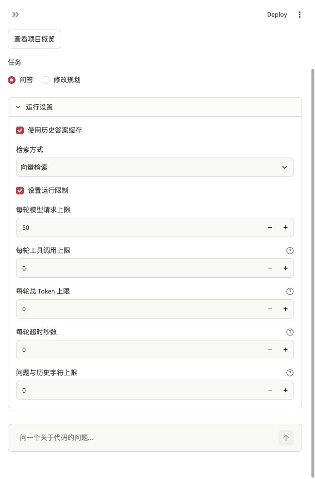

# 运行限制、用量与缓存开关验收

日期：2026-11-12。没有调用真实聊天模型，没有更换模型、依赖、嵌入、默认检索或缓存质量阈值。

## 本次能力

- `RunPolicy` 支持每轮 SDK 请求次数、成功工具次数、响应报告总 Token、异步超时及问题与历史字符限制。类型不合法时直接拒绝。
- 未传策略时不覆盖原 SDK 参数，原 50 次请求上限保留。页面默认不启用自定义限制。
- 字符超限在创建模型前拒绝，不截断历史。请求、工具、Token 超限或超时均不写入半轮历史，也不保存缓存；之前完成的轮次保留。
- Python 和页面可关闭缓存读写，检索方式可显式选择。成功回答保存本轮设置、实际 SDK 用量、请求与工具次数、耗时；旧记录兼容。

Token 根据响应报告检查，单次响应可能已超过阈值；SDK 步骤不包含其底层 HTTP 重试。超时取消异步等待，不抢占阻塞同步代码，不保证服务端取消收费。字符数不含系统指令、工具定义和本轮新工具结果。这些控制不能当作严格费用或模型窗口保证。

## 检查

8 项新增核心测试使用真实 Agent 与本地 `FunctionModel`，检查请求与工具超限、报告用量超限、超时取消、原历史不变、请求前字符检查、公共接口缓存开关和默认参数保留。另有 2 项页面测试检查显式设置传入以及记录展示；新增下拉项后，将原测试按控件名称定位，避免依赖排列顺序。旧测试中自行构造的结果补齐 SDK `usage()` 接口，没有给生产结果补造统计。

真实浏览器已检查默认向量方式、缓存开启、自定义限制关闭，以及主动开启后出现的五项限制。截图仅展示控件，没有提交模型问题；检查后恢复默认，原活动代码版本及索引未更新。

全量 251 项测试通过，81.706 秒，见[完整记录](20261112-runtime-unittest.log)和[机器可读记录](20261112-runtime.json)。原始失败日志保留在本地，修正后重新检查通过；没有重试真实模型任务。
