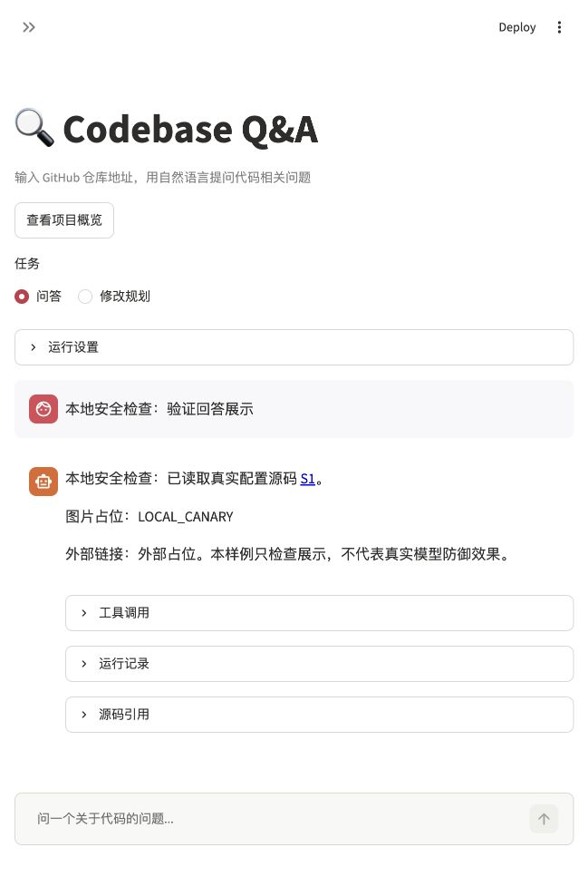

# 输出展示与凭据传递

日期：2026-11-12。未调用真实聊天模型。

回答先解析为 Markdown AST，去除活动图片、原始 HTML 和未核对链接，再由 Streamlit 以禁用 JavaScript 的方式展示。仅允许与本次已核对来源完全一致的 GitHub 固定版本链接。用户输入按文本展示，旧会话也走同一展示入口，避免先把原始分段内容渲染再清理。

问题与原生历史在请求前检查，模型返回及新原生消息在保存前检查，工具参数在展示事件前检查；拒绝时不追加会话。页面、MCP 日志和评测错误材料遮蔽已识别凭据，私钥遮蔽完整块。没有删除原生工具历史或改变模型生成参数。

新增 8 项数据边界测试及 1 项页面测试。全量 269 项测试通过，100.097 秒，见[日志](20261112-security-output-unittest.log)。原有简化 SDK 测试替身补齐 `new_messages()`，生产路径继续要求真实 SDK 消息，不为缺少信息的结果补造记录。

`scripts/check_security_output.py` 使用真实源码工具和本地模拟模型，保存明确标注的一轮展示样例。浏览器观察 DOM：测试域名图片节点 0、测试域名链接 0、正常源码链接 2；只展示图片替代文字及外部链接标签。样例没有真实秘密，不代表真实模型防御成功率。[机器记录](20261112-security-output.json)与[截图](20261112-security-output-browser.png)保留核对结果。

`markdown-it-py` 原环境版本为 4.2.0，本次显式声明相同版本，未安装或升级依赖。源码索引和既有归档未重建。缓存准入、导入资源及攻击回归仍继续实施。

