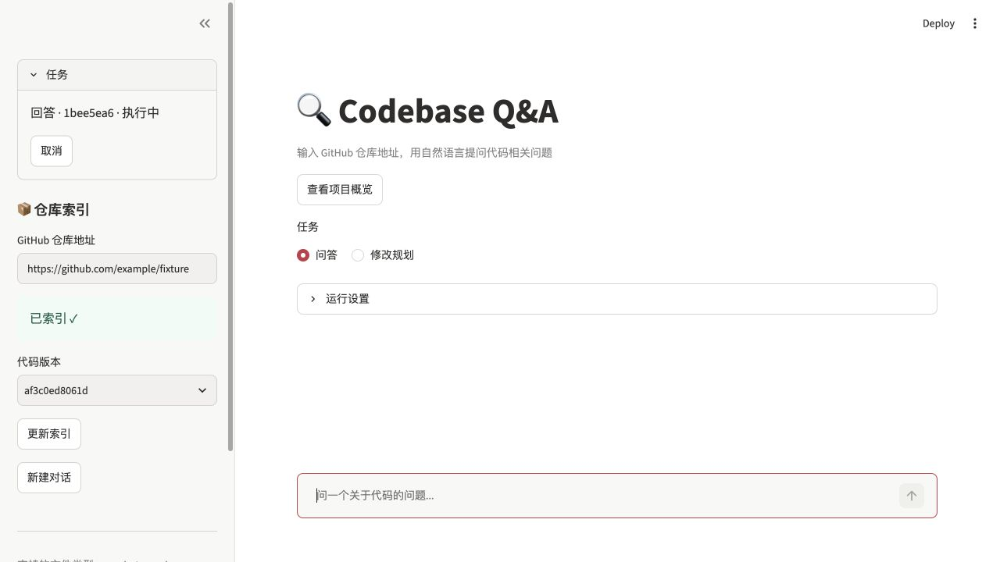
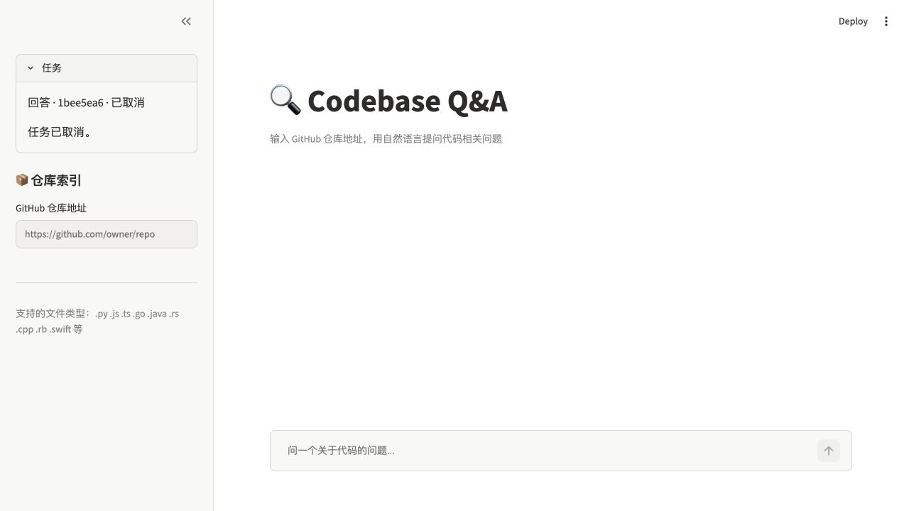
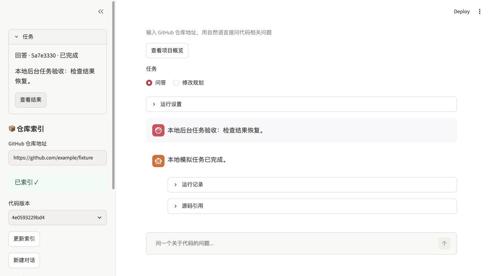

# 后台任务验收 · 2026-11-16

结果：全量 **358 项测试通过，125.779 秒，进程退出码 0**。其中新增 28 项任务检查、2 项 Git 清理检查。模型、嵌入设置和 194 个依赖未安装或升级；真实模型调用为 0，真实 OIDC、HTTPS 和公网负载未验收。

- [完整测试日志](20261116-tasks-unittest.log)、[实现与配置摘要](20261116-tasks.json)。
- 全量通过后补齐正常关闭不误报调度故障的分支，28 项任务检查再次通过，3.850 秒、进程退出码 0，见[关闭检查](20261116-tasks-shutdown.log)。摘要中的实现指纹对应最终文件，原全量日志原样保留。
- [57 项定向检查](20261116-tasks-targeted.log)覆盖 Git 边界、任务、页面及异步生命周期；后续增加故障不可用检查，最终结果以 358 项全量日志为准。
- [13 个固定攻击检查](20261116-tasks-prompt-attacks.json)全部通过，真实模型攻击防御率仍为空。
- [真实 MCP](20261116-tasks-mcp.json)：9 个工具、14 次调用通过，网络导入默认关闭，活动索引未重建。
- 固定评测数据仍为 16 题、19 轮、31 段证据，状态未运行。原会话仍为 2 个、3 轮，内容摘要 `9fd14008178680c699d441cd6e83dd0056b35b1f4c0faf206df92afec7de647f` 不变；活动源码 `7ed1f8f`、58 分块不变。

## 检查范围

真实临时 SQLite 事务验证竞争接单、幂等、不同输入复用拒绝、排队数、用户和全局每日次数、UTC 换日与逻辑存储预算。失败、取消不返还次数；并发请求不会超支。同一会话限制一个未完成任务，同一仓库的同步导入不会并行。

双用户、管理员、过期及撤销身份分别检查提交、列出、结果、取消和后台发布。模型输入不能提供 owner、role、源码根路径或命令。状态区单独刷新也重新认证，不能复用上一页的授权。

真实 SDK FunctionModel 验证后台问答、原生多轮消息、取消清理及取消后不写半轮。导入使用真实临时 Git 快照和模拟向量集合；在新集合构建后取消，旧就绪索引保持可用，本次未发布集合清理。同步导入超时/取消保留槽位直到线程返回。

另一个真实 Python 子进程不能打开已持锁队列。重启后旧排队、运行、取消中任务标为中断，处理器不自动执行或重发模型请求。调度器不可用时先报错，不继续展示假排队或读取私有任务。

## 浏览器

隔离页面使用临时 Git/SQLite 和本地 FunctionModel，不请求真实模型。实际浏览器完成运行中查看、刷新后同一任务仍在执行、取消，以及完成后刷新再打开结果。取消记录为 1 项、原生轮次为 0；独立完成记录为 1 项、原生轮次为 1。截图不是实际模型或真实 OIDC 的成功凭据。

## 保留的失败与修正

前两轮完整检查分别为 353、355 项，均因原 Git 清理的 `PermissionError` 失败，没有记作通过。资源超限是预期拒绝，清理信号错误覆盖了它；进程退出竞争是工作假设，不能说已取得失败瞬间的完整进程组证据。新增清理逻辑只在确认子进程已经退出时接受信号错误，活进程仍报错；确定性测试覆盖两种情况，没有增加原 Git 时限或更改资源参数。该修复先单独提交并推送 `2543c2c`。

原始失败日志在本机 `.baseline_runtime/` 保留，摘要记录在 JSON 中。诊断轮期间更新任务列表字段，旧模块仍驻留进程，两个 UI 检查未通过；统一加载最终代码后重新检查。没有将诊断轮当作成功结果。

两个旧 UI 子进程测试最初没有注入临时任务队列，产生了 20 条本地模拟任务记录。核对后完整移到 `.baseline_runtime/tasks-test-records-20261116/`，未删除记录；原业务会话与索引未受影响。已改成各自临时目录，两个子进程独立复查及最终全量均通过，默认任务库未产生测试数据。

## 边界与下一步

当前是单服务进程队列；支持页面断开后继续执行，进程重启不自动恢复。任务库与会话/索引不是跨库原子事务，极端中断可能留下已保存回答和中断任务，应先核对历史，不盲目重跑。限额不是 API 费用、整个数据盘或主机 CPU/内存硬限制；同步库及服务商已收请求不能保证即时取消。

下一项为依赖漏洞审计、部署和运维，包括入口限流、主机资源约束、备份恢复及健康检查。真实登录、模型基线、质量和真实攻击验收继续等待密钥。功能提交的远端结果以该提交的 Actions 为准；本记录生成时尚未推送功能提交。
